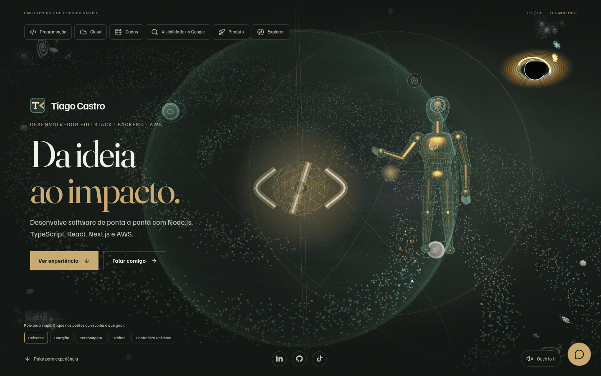
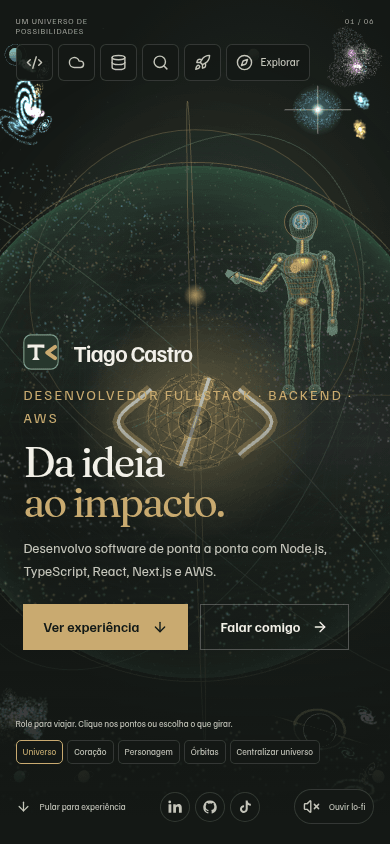

# Tiago G Castro | Portfolio V2

Professional portfolio of Tiago Castro, a Full Stack Developer focused on backend systems, cloud architecture, AWS, data, and production software.

[tiagogcastro.com.br](https://tiagogcastro.com.br)

## Preview

<p align="center">
  <a href="https://tiagogcastro.com.br">
    
  </a>
</p>
<p align="center">
  <a href="https://tiagogcastro.com.br">
    
  </a>
</p>

## About V2

V2 is a single-page portfolio that connects business context, engineering decisions, and measurable production results. The content follows one continuous narrative:

1. An interactive cosmic hero introduces the areas of work.
2. Experience presents the LakeIT and FutBuyNow case studies.
3. Education and credentials group the degree, AWS certifications, and courses.
4. Projects highlight NexSift and selected open source work.
5. Method explains how products move from context to production.
6. Contact provides direct channels, work modes, and international availability.

The separate experience and project routes from the previous version were removed. Localized visitors stay on the same landing page and can move directly between sections.

## Main Features

- Procedural Three.js hero with a navigable scroll journey, capability chapters, discoveries, optional synthesized audio, and a CSS fallback.
- Responsive case studies with image galleries, keyboard controls, captions, and a lightbox.
- Real technology marks from Simple Icons, with Lucide reserved for interface actions and concepts.
- Mobile-specific layouts with compact copy, internal horizontal technology lists, and an accessible menu.
- Brazilian Portuguese, English, and Spanish content powered by `next-intl`.
- Fraunces for display typography and Familjen Grotesk for headings, body copy, labels, and controls.
- Static localized Open Graph PNGs, metadata, JSON-LD, sitemap, robots, and localized manifests.
- Downloadable resumes in Portuguese and English.
- Vercel Analytics and Speed Insights.
- Reduced-motion behavior and readable fallbacks for constrained viewports.

## Case Studies and Projects

- **LakeIT:** enterprise data platform involving AWS, infrastructure as code, data pipelines, cost control, and applied AI.
- **FutBuyNow:** international marketplace covering payments, sellers, affiliates, loyalty, SEO, analytics, automation, and technical ownership.
- **NexSift:** technology radar that filters and contextualizes signals using verified sources.
- **Selected projects:** open source work involving APIs, cloud, payments, architecture, and developer tooling.

## Tech Stack

- Next.js 16 and React 19
- TypeScript in strict mode
- Tailwind CSS 4
- next-intl
- Motion
- Three.js
- Simple Icons and Lucide React
- Yarn 4 with Corepack

## Routes and Localization

- Brazilian Portuguese: `/`
- English: `/en-US`
- Spanish: `/es-ES`

All visible copy, accessible labels, metadata, and structured data are maintained in:

```text
messages/pt-BR.json
messages/en-US.json
messages/es-ES.json
```

Localized Open Graph images are static files under `public/og/`.

## Running Locally

Requirements:

- Node.js 20.9 or newer
- Corepack enabled

```bash
corepack enable
yarn install
yarn dev
```

The development server starts at [localhost:3000](http://localhost:3000). No environment variables are required.

## Scripts

```bash
yarn dev        # start the development server
yarn lint       # run ESLint
yarn typecheck  # generate route types and check TypeScript
yarn build      # create a production build
yarn check      # run lint, type checking, and build
yarn format     # format files with Prettier
```

## Project Structure

```text
messages/               localized copy and metadata
public/brand/           brand and partner marks
public/images/cases/    case-study screenshots
public/og/              localized Open Graph PNGs
public/projects/        project screenshots
public/resume/          downloadable resumes
src/app/                routes, metadata, manifests, and global styles
src/components/         shared UI, layout, brand, and visual components
src/config/             public site configuration and localized links
src/content/            structured project content
src/features/home/      landing-page sections and cosmic hero
src/i18n/               locale routing and request configuration
```

## Quality Gate and Deployment

Run the complete verification pipeline before opening or merging a pull request:

```bash
yarn check
```

The site is deployed to Vercel through Git integration. Production requires no environment variables.

## License

The source code is available under the [MIT License](LICENSE).

Resumes, biographical information, case-study content, screenshots, professional data, and visual identity assets are excluded from the code license. See the [Content Notice](CONTENT_NOTICE.md) for details.
